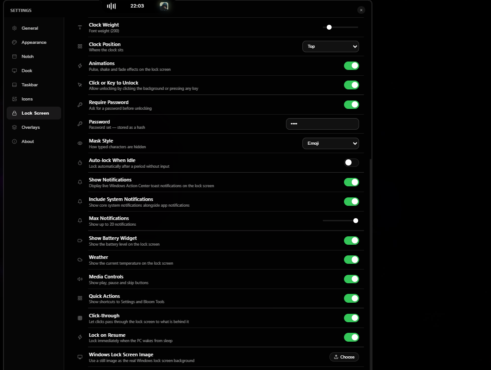
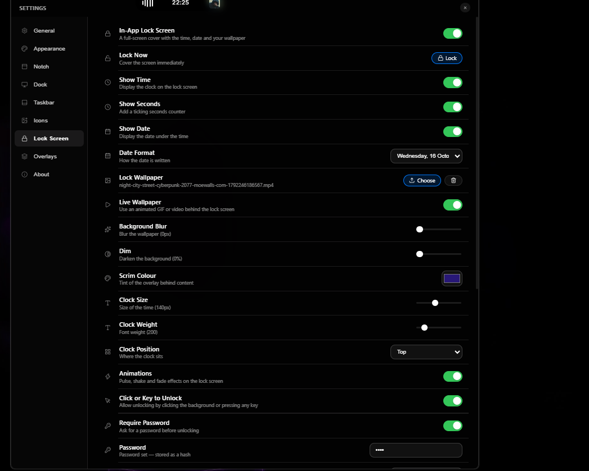
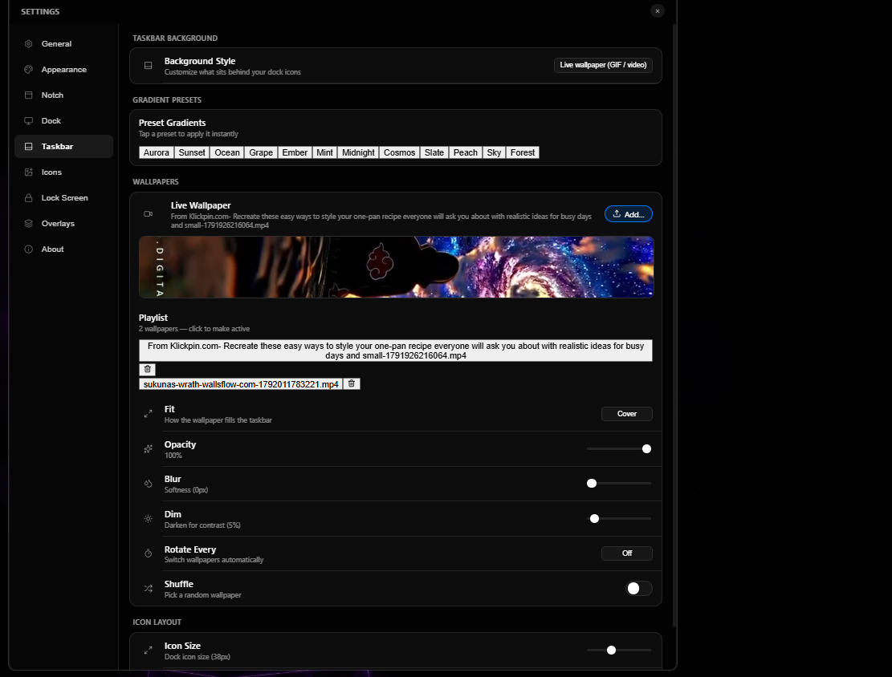
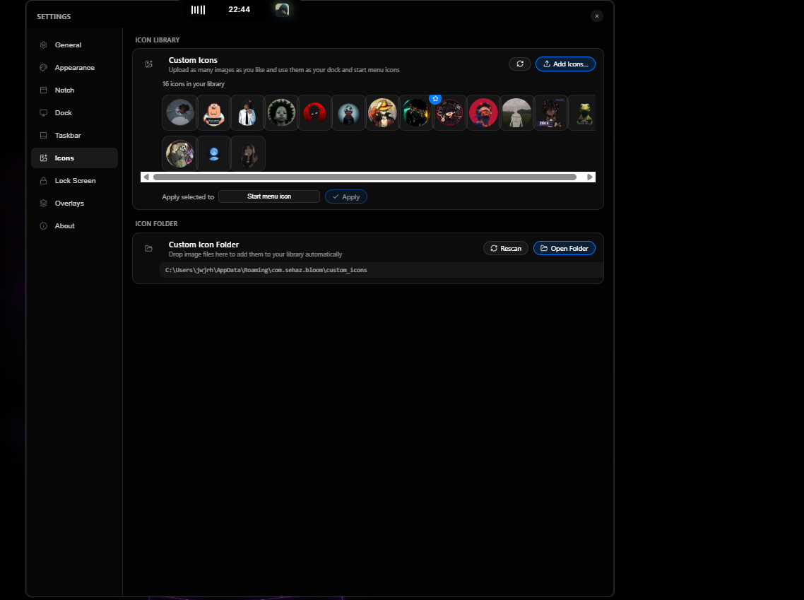
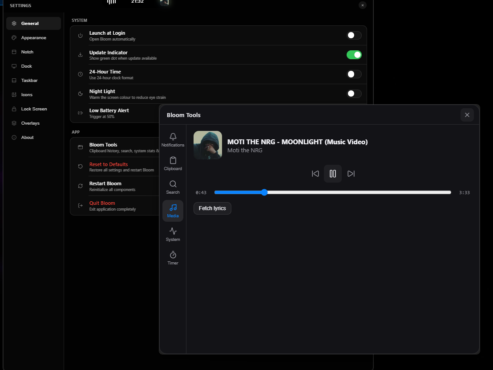
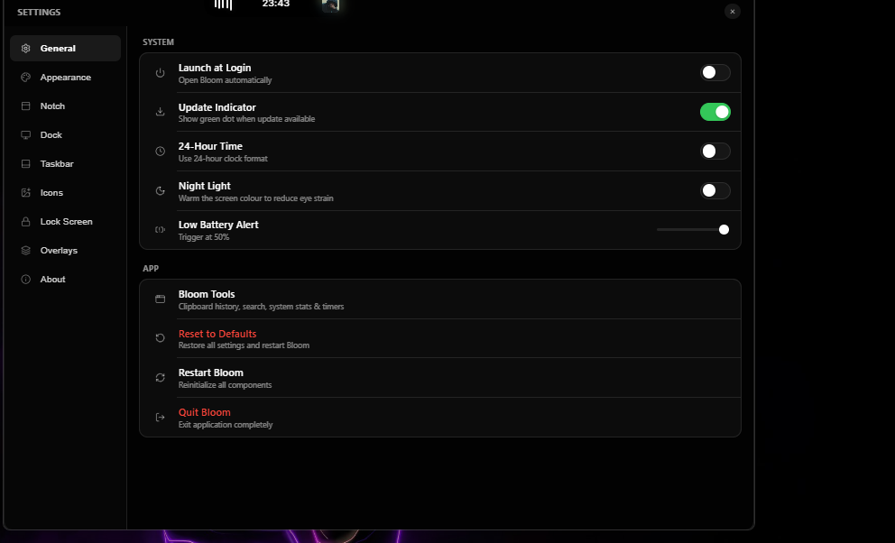
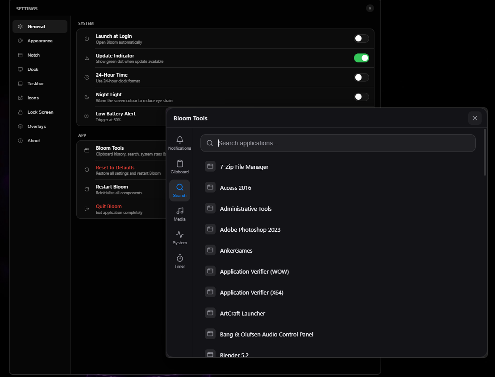
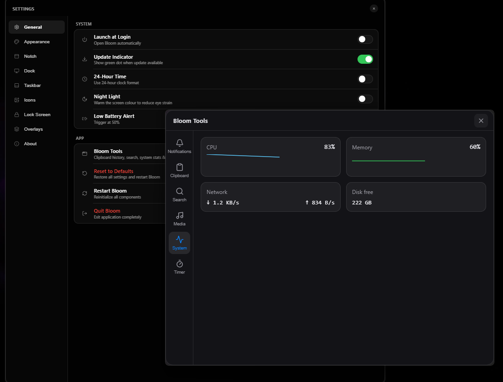

# Bloom — Custom Fork Changelog

This repository is a personal fork of [SehajveerSingh2005/bloom](https://github.com/SehajveerSingh2005/bloom.git),
based off the `v3.9.2` codebase and versioned as **Bloom v3.9.0**.

Everything listed below is present in this fork but **not** in upstream, verified by
diffing this tree against upstream at both the `v3.9.2` tag and `main` (3.10.0).

---

## Screenshots

**Lock screen**
| Lock screen options | Live wallpaper |
| --- | --- |
|  |  |

**Desktop & taskbar**
| Taskbar with live wallpaper | Custom app icons |
| --- | --- |
|  |  |

**Bloom Tools**
| Media controls | Tools shortcut |
| --- | --- |
|  |  |

**Other**
| Find a program | System check |
| --- | --- |
|  |  |

**Live wallpaper demos (video)**
- [Lock screen live wallpaper (mp4)](docs/screenshots/lockscreen-live-wallpaper-demo.mp4)
- [Taskbar live wallpaper (mp4)](docs/screenshots/taskbar-live-wallpaper-demo.mp4)

---

## 1. In-app Lock Screen — entirely new

New window, page and settings tab: `lock.html`, `src/lock-main.tsx`, `src/LockScreen.tsx`,
`src/LockScreen.css`, `src/settings/LockScreenTab.tsx`, `src/lib/hash.ts`.

- Password unlock — password is stored hashed (`src/lib/hash.ts`), not in plain text
- Optional unlock gesture
- Auto-lock after a configurable idle timeout
- Lock-on-resume — re-locks automatically after sleep / hibernate
- Widgets on the lock screen: clock, date, weather, battery, media controls
- Notification list rendered on the lock screen (incl. system notifications)
- Quick actions row
- Background options: custom wallpaper, live wallpaper, and "use the Windows lock screen image"
- Clock styling: position, size, weight, show time / seconds / date, date format
- Appearance: scrim color, dim, blur, mask style, animations, click-through
- Hides the dock, top bar and native taskbar while locked, so the screen reads like the
  Windows lock screen (wallpaper + lock UI only) and restores them on unlock

## 2. Bloom Clock widget — new

New window and page: `clock.html`, `src/clock-main.tsx`, `src/ClockWidget.tsx`, `src/Clock.css`
(`bloom-clock-*` settings).

- Standalone desktop clock window with size, position, wallpaper, seconds and date options

## 3. Bloom Tools window — new

New window and page: `tools.html`, `src/Tools.tsx`, `src/Tools.css`.

- Media controls and synchronized lyrics (CSP extended with `media-src` and `https://lrclib.net`)

## 4. Night Light — new

New module: `src-tauri/src/night_light.rs` (`bloom-night-light-*` settings).

- Warm screen tint with adjustable intensity

## 5. Custom Icon Library — new

New tab and helpers: `src/settings/IconsTab.tsx`, `src/settings/IconFolderRow.tsx`,
`src/iconLibrary.ts`, `src/hooks/useIconLibrary.ts`.

- Import custom icons from a folder and override icons per application

## 6. Taskbar Background & icon sizing — new

New tab and helpers: `src/settings/TaskbarTab.tsx`, `src/taskbarBackground.ts`.

- Background image / gradient / colors, fit, opacity, blur, dim and angle
- Icon size and icon gap

## 7. Dock additions — new

- Dock clock (`bloom-dock-clock-*`)
- Dock magnification with adjustable strength (`bloom-dock-magnify`, `bloom-dock-magnify-strength`)

## 8. Media / Notch additions — new

- Music mode and a compact notch media player (`bloom-music-mode-enabled`, `bloom-music-compact-notch`)
- Lyrics via LRCLIB

## 9. Miscellaneous — new

- Notification history (`src-tauri/src/notifications.rs`, `get_notifications`)
- Calendar widget toggle (`bloom-calendar-enabled`)
- Custom Start icon (`bloom-start-icon`)
- Battery indicator with low-battery threshold (`get_battery_level`, `bloom-low-battery-threshold`)
- Banner cleanup: the in-app lock screen no longer shows a close/dismiss (✕) button

## 10. Self-updater disabled

`src-tauri/src/updater.rs` is neutered in this build so it can never overwrite the fork
with an official upstream release:

- `run_startup_check` is a no-op
- `check_for_updates` reports no update
- `install_update` returns `Err("Updates are disabled in this build")`

---

## Not from this fork

The following exist in upstream `main` (3.10.0) but **not** here, because this fork is based
on `v3.9.2`: dock drives / recycle bin / folders, shelf, native tray menu, app previews,
Win+number dock, Bluetooth and Wi-Fi panels, and upstream's diagnostics module.
